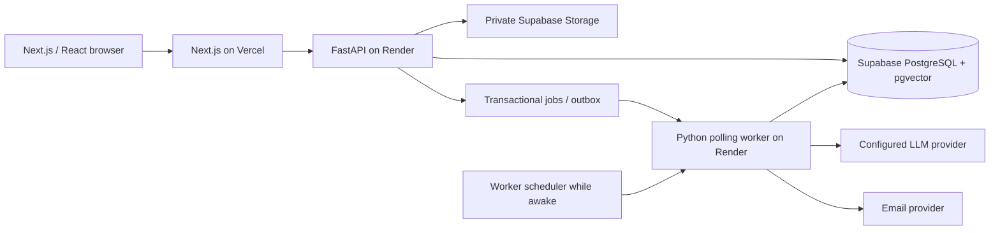

# Personal AI Planner migration

[Documentation home](../README.md) · [Current decisions](../architecture/decisions.md) · [Open issues](../issues.md)

Written before implementation on 2026-11-07. Branch: `feat/personal-ai-planner-v1`.

## Scope and working assumptions

The approved target is Next.js / React / TypeScript, FastAPI / Python, and PostgreSQL / pgvector. Implement after this plan, as explicitly requested. Preserve the dirty working tree that existed before migration. Keep PHP, JavaScript, MySQL migrations, existing tests and private storage intact as the reference and rollback path until verified cutover; the new runtime lives in `apps/`. No production database or external deployment is changed by local implementation.

V1 serves personal accounts: Notes, Areas, hierarchical Goals, Milestones, Tasks, Habits, Calendar, Dashboard, Reviews, reminders, attachments, authentication and preferences. Teamwork, including team Goals/Tasks/chat, is permanently removed from both runtimes by user decision. Live collaborative editing is excluded from the new runtime. Team records must survive in a verified archival export. Simple registered-account Note sharing remains in scope. Existing offline Notes, account recovery/verification/2FA, accessibility and English/Vietnamese behavior require explicit parity evidence before replacing the existing app; a new shell alone is not parity.

## Implementation sequence and acceptance gates

### Permanent Teamwork removal (user decision, 2026-11-07)

Teamwork is removed from the product, including the retained PHP/JavaScript runtime. This supersedes earlier wording that merely excluded it from V1. Note sharing and its existing access controls remain in scope.

1. Remove Teamwork routes, service/controller/repository/domain code and browser module/view. Separate accepted Note-sharing contacts from the Teamwork controller before removing it. Verify removed route families return 404 and Note-sharing contacts remain owner-scoped.
2. Remove assigned-team Dashboard work, team reminder/notification delivery, navigation, tour/guide content, demo seeding/capture, styles and feature-specific tests. Retain independent account moderation, Note sharing and personal TaskSeries behavior. Verify affected personal flows with narrow isolated checks.
3. Update maintained boundaries, route/component traces, tests and diagrams; remove dangling imports/references. Verify documentation generation and the changed source files.
4. Preserve historical migrations and existing MySQL rows without executing schema/data deletion. The read-only migration snapshot/raw-record archive continues preserving unknown legacy rows, including retired Teamwork data; this compatibility path does not expose an application feature. No live database mutation or conversion of team records to personal work is part of removal.

The existing UI is provisionally accepted by the user. Checks for this removal are separate from completing the wider UI-to-backend integration.

| Step | Deliverable | Verification required |
| --- | --- | --- |
| M0 — baseline and plan | Separate branch, feature/security inventory, architecture, skills audit, data/cutover strategy | Read legacy services and representative domain/integration tests; preserve existing local edits |
| M1 — platform | Python package, FastAPI, typed settings, SQLAlchemy, Alembic, PostgreSQL + pgvector, Next.js App Router, isolated local/CI environments | Reproducible dependency locks, schema upgrade, health/readiness, frontend production build, CI against disposable PostgreSQL |
| M2 — identity and boundaries | Opaque cookie sessions, CSRF/origin verification, password hashing, session revocation, preferences, owned queries, private files | Two-user negative access tests, invalid/expired sessions, forged origins, locked Notes and file authorization, upload size limits |
| M3 — personal planning | Areas/Goals/Milestones/Tasks/Notes/Habits/Reviews, graph validation, versions, Calendar/Dashboard, autosave conflicts | Transaction rollback, concurrent version rejection, hierarchy/prerequisite cycles, archive semantics, UTC/date separation, habit/recurrence fixtures |
| M4 — asynchronous work | Durable jobs/outbox, lease/retry/idempotency, recurrence, reminders, indexing, separate worker | Crash/retry/duplicate delivery, stale index invalidation, no LLM or mail calls in business requests or database write transactions |
| M5 — AI | User-scoped hybrid retrieval, cited answers, provider boundary, tool proposals, explicit atomic confirmation, quotas and usage | Retrieval isolation/locked/deleted-note tests; prompt injection fixtures; stale/expired/replayed proposal tests; deterministic provider fakes and offline evaluations |
| M6 — migration and cloud | Read-only MySQL snapshot/export, staging import/reconciliation, immutable Team archive, containers, CI and cloud deployment procedure | Import rerun, FK/owner/link checks, counts/checksums, private file manifest, backup restore and rollback rehearsal on isolated data |
| M7 — acceptance | Product parity matrix and browser flows, load/evaluation baseline, deployment readiness report | Fresh-account browser flow; two-account isolation; mobile/keyboard; p95/p99/error/cost evidence; documented gaps block production cutover |

Do not mark a milestone complete merely because its files exist. Track current implementation and unverified parity in the open-issue list. Legacy tests remain runnable against their original stack. Port behavior fixtures into pytest and browser tests; replace DOM/PHP-specific assertions rather than mechanically translating tests or lowering assertions to obtain green checks.

## Architecture decision

Deployment update (2026-11-08): the user selected [Render + Vercel + Supabase](render-vercel-supabase.md); Funnel remains the local fallback. The original Cloud Run design is retained only as an alternative runbook.

Use a modular monolith, one Python package and one database, with separate API and worker processes from the same image. Domain modules own validation and transactions. Avoid a service mesh, independent domain databases, a generic workflow engine and a framework for agents until actual requirements justify them.

Keep the browser API same-origin through Next.js. FastAPI is the sole authority for business rules and authorization, including requests that bypass Next.js. Use HttpOnly opaque cookies (hashed session tokens in the database), explicit CSRF tokens and allowed-origin checks. No browser bearer token in localStorage. Session revocation and per-Note unlocks must work across replicas. Public API and authenticated worker ingress are separate deployment entry points. Worker delivery is at least once; idempotency is a database invariant, not a queue promise.

SQLAlchemy 2 and Alembic provide typed persistence and forward migrations. Use bounded connection pools and instance caps: maximum instances × per-process pool must fit the managed database budget. PostgreSQL constraints enforce owned relationships where possible; serialize graph mutation per owner and validate within the same transaction. Keep user-facing dates as `DATE`, instants as `TIMESTAMPTZ` in UTC, and IANA timezones for schedules. Lists use pagination, bounded projections and indexed owner/filter/sort columns. Business GETs do not materialize recurrence or write activity.

Start with durable PostgreSQL jobs locally and support managed delivery on cloud. A committed outbox prevents lost jobs between database commit and task dispatch. Leases, bounded retries/backoff, dead-letter state and unique occurrence/reminder/index keys prevent duplicate business effects. Provider network calls occur outside write transactions; results are committed only after source/version/permissions are checked again. Do not use FastAPI in-process background tasks for durable AI work.

## AI design

Index versioned chunks with source kind/ID, owner, content hash, model and embedding dimensions. Locked Notes are excluded entirely, including titles, snippets, summaries and embeddings, even when a session has unlocked one. Revocation, locking, archival or deletion must invalidate retrieval immediately through source-table checks; index cleanup can be asynchronous. Do not reuse legacy vectors with an incompatible embedding model.

Combine PostgreSQL full-text ranking and pgvector cosine ranking with reciprocal-rank fusion. Apply ownership and source eligibility within retrieval SQL, then revalidate returned sources. Start with exact owner-filtered vector ranking; enable HNSW/iterative scanning only after a measured recall/latency benchmark. No separate vector database is needed initially. Cite only sources actually retrieved for this request.

An assistant run is durable and quota-reserved before enqueue. The worker retrieves context and invokes a provider through a narrow adapter; model/base URL/credentials remain server configuration. Expose typed read context and proposal tools. Retrieved content is untrusted data, never authority. Mutations are proposals only, bound to the requesting user, canonical payload hash, observed entity versions and expiry. Explicit user approval reauthorizes every reference and invokes ordinary domain services in one transaction. Stale or unauthorized references abort all operations. Applied proposals replay without duplicate effects.

Store provider/model, input/output token counts, latency, status, trace ID and estimated cost without logging raw private prompts. Enforce per-user run/token budgets, bounded context, maximum tool steps and output size; retain usage on failed/cancelled calls conservatively. Use deterministic fakes in ordinary tests. Live evaluation requires configured credentials and synthetic data; no passing live-provider claim without execution.

## Product and test preservation

| Legacy contract | New verification |
| --- | --- |
| Owned reads/writes return 404 across accounts | HTTP tests with distinct owners for every resource and relation |
| Arbitrary-depth single-parent Goal tree; separate acyclic prerequisites | Domain fixtures, inverse-edge/concurrent transaction cases |
| Task primary parent differs from contributions | Explicit typed relations; no progress double counting |
| Today/week manual selections do not change schedule | Dashboard/Calendar/selection tests across local midnight |
| Note autosave preserves a draft on conflict | Versioned update and browser conflict/retry test |
| Locked Notes never enter AI/offline/storage previews | Search/index/file/share tests before and after lock changes |
| Finite progress excludes Habits/series/contributions | Port legacy calculator fixtures before cutover |
| Recurrence clamps month/year dates; Ended is terminal | Month-end/leap-year/DST and duplicate materialization tests |
| Habit timezone freezes after first check-in; rest is not completion | Date-window, daily/weekly streak and rest fixtures |
| AI Apply is explicit, scoped, versioned and atomic | Forged approval, cross-owner refs, stale versions, rollback, replay |
| Attachments remain private | MIME/size/path and owner/shared/locked download tests |
| Account verification/recovery/2FA revoke sessions correctly | Token expiry/single-use/rate-limit/pending-identity tests |
| Offline Notes clear on logout and exclude locked text | Browser storage/outbox/account-switch tests |

## Data migration and cutover

1. Inventory every source table/column and private file. Export from a consistent read-only snapshot to an access-restricted directory outside Git/public roots, with format version, row counts, checksums and file manifests. Never run legacy integration cleanup against the live source.
2. Preserve original IDs through a mapping table when target types change. Convert UTC instants explicitly; preserve calendar dates, versions, tags, relationships, archives/tombstones, password hashes and lock hashes. Invalidate sessions, reset/email tokens and old embeddings. Compatible legacy bcrypt passwords are verified once and rehashed to Argon2id on login.
3. Import into an empty staging PostgreSQL database using an explicit target allowlist. Fail on malformed/orphan/cross-owner relations or unknown mappings. Make imports transactional and rerunnable through source IDs/checkpoints, with no silent drops. Keep all original rows, including unsupported fields, in an immutable private archive.
4. Archive Teamwork tables and their referenced users/files together, with checksums and tested export access. Do not turn team records into personal tasks without an approved ownership mapping.
5. Reconcile counts, relationships and file checksums and rehearse backup restore. Run full parity acceptance on migrated staging data. Then freeze source writes, take the final snapshot, reconcile again, and switch ingress. Avoid dual writes.
6. Retain the old database/files read-only during a defined rollback window. Roll back traffic only before accepting new writes, or export/reconcile new writes first; routing back after new writes without reconciliation loses data.

## Cloud and commercial release gates

Vercel hosts `apps/web`; Cloud Run hosts the API and authenticated worker; managed PostgreSQL supports pgvector; private object storage holds uploads. Managed scheduler triggers recurrence/reminders/outbox dispatch. Secrets use platform secret stores and CI uses workload identity rather than committed service-account keys. Separate development/staging/production resources. No dependency on a personal machine or Tailscale.

Before a paid release: tested account verification/recovery/2FA, per-user AI/storage/rate budgets, privacy/export/deletion, encrypted backup/PITR and restore drill, monitored worker failures, error tracking, request traces and run usage, dependency scanning, and rollback drill. Billing/subscriptions are a separate product decision; resource quotas are required now. Choose region, budget, domain and service providers at deployment time with real account access.

Performance targets are provisional acceptance budgets, not measured results: business API p95 ≤ 250 ms / p99 ≤ 750 ms (excluding uploads and AI) at the agreed synthetic workload; <1% errors; 100 concurrent personal users as the first load stage. Record dataset size, machine/instance limits, warm/cold behavior, worker load, query counts and cost before changing these targets. LLM latency has a separate queue/first-token/total-time budget.

## Skills audit and evidence policy

The repository contains only Karpathy Guidelines, duplicated through three agent discovery paths. Retain one canonical copy and compatible references; there is no obsolete framework-specific skill to delete. Do not uninstall unrelated user-wide skills. Use Karpathy Guidelines for implementation, Senior Architect for decisions, Frontend Design for the interface, and Playwright for browser verification. Skill titles/popularity are not evidence of authority. Prefer maintainer-owned technical documentation, lock dependencies, inspect licenses/provenance and install no unreviewed third-party skill.

Primary references checked during planning:

- [FastAPI background tasks and worker caveat](https://fastapi.tiangolo.com/tutorial/background-tasks/)
- [Next.js external rewrites](https://nextjs.org/docs/app/api-reference/config/next-config-js/rewrites)
- [pgvector filtering and indexing](https://github.com/pgvector/pgvector)
- [Cloud Tasks duplicate delivery and execution behavior](https://docs.cloud.google.com/tasks/docs/common-pitfalls)
