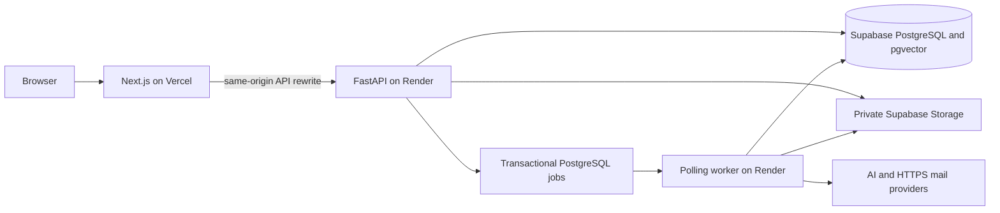

# Personal AI Planner scope and acceptance plan

[Documentation home](../README.md) · [Current status](status.md) · [Decisions](../architecture/decisions.md)

The migration was designed on 2026-11-07 and is now integrated on `main` under `apps/`. The PHP/JS runtime was subsequently retired and removed in `8714dc0`. Historical instructions to retain that source tree as runnable rollback are superseded; preserve Git history/private data backups instead. This document retains approved scope and outstanding acceptance requirements, not an instruction to re-run the completed migration.

## Scope

Personal accounts: Areas, hierarchical Goals, Milestones, Tasks, Habits, Calendar, Dashboard, Notes with registered-account sharing/passwords/private files/offline recovery, Reviews, reminders, attachments, authentication/MFA/recovery and preferences. Teamwork is permanently removed; historical rows belong in private archival preservation. Realtime collaborative editing is excluded from V1. English/Vietnamese, keyboard/responsive behavior and historical-data compatibility need explicit evidence.

## Architecture

Use a modular monolith with separate API/worker processes and one database. FastAPI is the authority for sessions, ownership, validation and atomic writes, including direct calls bypassing Next.js. Opaque HttpOnly cookies, exact Origin/CSRF checks and server-side session/password/MFA state protect account access. AI compiles one proposal; only explicit exact confirmed Apply changes domain data. Private storage is never public. Queue delivery is at least once with durable leases/idempotency.

## Implementation and verification gates

| Area | Implemented source / required evidence |
| --- | --- |
| Platform | Locked dependencies, FastAPI/Next.js, Alembic/pgvector, isolated tests/CI; run build/schema checks for each change |
| Identity | Cookie sessions, CSRF/origin, revocation, Note unlock, authorized files; exercise two-user negatives and expiry |
| Domain | Owned personal entities, graphs, versions, archive/restore, calendar/plans; exercise cycle/concurrency/rollback/date rules |
| Jobs | Durable scheduling, mail, recurrence, retention/indexing; verify crash/retry/idempotency and sleep/recovery |
| AI | Scoped hybrid retrieval, named tools, durable history/proposal; verify stale/replayed/expired/foreign/locked sources and model quality separately |
| Data/cloud | Recorded hosted deployment; still requires full reconciliation, private bytes, managed restore and operator release evidence |
| Human acceptance | Historical fixtures, localization, responsive/keyboard/visual review, realistic load and provider/cost evaluation |

Do not mark behavior equivalent merely because a route renders or assertions pass. Use representative fixtures; never weaken expectations to hide a regression. Source/test entry points live in current UI maps, not removed PHP paths.

## Data migration and cutover

The [legacy importer](../../apps/api/planner/migrate_legacy.py) exports read-only source data, verifies snapshots/checksums and imports into guarded staging/test targets; an explicitly authorized development merge has additional backup/rehearsal/name checks. Preserve unknown fields/Teamwork rows privately and never reactivate removed features. Source accounts with incompatible MFA require assisted recovery. Do not reuse legacy sessions/tokens/vectors.

For any further transfer: verify intended source/target, stop incompatible writers, back up database and private files, rehearse on isolated infrastructure, reconcile counts/owners/graphs/dates/content/checksums, exercise account/MFA/file workflows and rehearse restore/rollback. Keep unsupported data preserved and visible in the reconciliation report. The raw cloud COPY helper is not this acceptance procedure (ISSUE-065).

The recorded deployment and legacy source removal do not prove full reconciliation or rollback readiness. Outstanding gates remain ISSUE-045–048. Do not route back to MySQL after new PostgreSQL writes without reconciling them; the old app is no longer a runnable tree here.

## Operating boundaries

The recorded Render Free topology colocates API/polling worker; sleep delays jobs. `render.yaml` selects `main` and manual deployment, not automatic rollout on push. Pool capacity counts every API/worker process plus migrations/admin headroom. Zero configured AI prices mean unpriced usage. Paid/provider budgets, tracing, restore objectives and realistic workload targets need measured acceptance. Google Cloud Run/Tasks remains an alternative, Funnel a local fallback. See [cloud operations](../operations/cloud.md).
