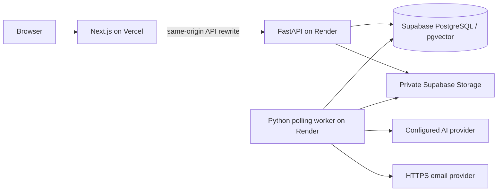

# Render, Vercel and Supabase deployment

[Routes](deployment-routes.md) · [Status](status.md) · [Open issues](../issues.md)

The user selected this cloud combination on 2026-11-08. The repository includes a free-tier trial configuration; account/project linking, public endpoints, credentials and hosted acceptance are still required. No cloud resources or user-data transfer were performed during preparation. Funnel remains the working local fallback. Assistant context selection remains deferred under ISSUE-063.

**Work is paused at the user's request.** See the [handoff](deployment-handoff.md) for verified changes, missing account configuration and the exact resume point.

## Topology and Free limitations



[render.yaml](../../render.yaml) requests one **Free web service**. The Docker entry point supervises separate API and polling-worker processes in that container. Jobs, leases and retries remain durable in PostgreSQL rather than request-local background tasks. A child failure stops its sibling and exits the container. Forward migrations run before either process starts. No paid worker, disk or Render database is requested.

[Render Free](https://render.com/docs/free) sleeps after 15 minutes without inbound traffic, may restart and has ephemeral storage. Both processes pause while asleep. New traffic wakes the service, but overnight reminders/recurrence/retention are not guaranteed to run on schedule. Interrupted jobs resume after lease expiry and normal retries. Do not add fake keepalive requests or describe the trial as always-on. Monthly service-hour and external service-initiated traffic limits also apply.

For continuous background processing, create a paid Render worker from the same image with command `python -m planner.jobs`, `PLANNER_WORKER_MODE=poll` and the same private settings. Set `PLANNER_RUN_WORKER=false` on the API and run migrations before releasing the worker. Start with one worker. API sleep is independent if it remains on Free. Billing changes require a separate operator decision.

## Supabase preparation

Use a dedicated project/environment. FastAPI retains account authentication, sessions, ownership and Note permissions; this route does not migrate accounts to Supabase Auth.

1. Enable the `vector` extension for the existing 1536-dimensional embeddings.
2. Use application schema **`planner`**; leave it out of Data API exposed schemas and grant no `anon`/`authenticated` access. Disable Data API if unused. See [API isolation](https://supabase.com/docs/guides/api/securing-your-api). Alembic creates its tables/version record in the selected schema; local development retains `public`.
3. Copy the actual **Connect → Session pooler** string, using port 5432 when IPv4 is needed. Use `postgresql+psycopg://` and require TLS. Do not guess the pooler hostname or role suffix. Direct connections may require IPv6; transaction mode on port 6543 has prepared-statement/session-state restrictions. See [connection modes](https://supabase.com/docs/guides/database/connecting-to-postgres).
4. Create **`planner-private` as a private bucket** with no anonymous read/write policy. API file routes authorize every request and proxy bytes; no public object URLs are returned. The adapter uses the server-only legacy `service_role` JWT, never an anon/publishable key. See [private buckets](https://supabase.com/docs/guides/storage/buckets/fundamentals) and [service keys](https://supabase.com/docs/guides/storage/security/access-control).

API and worker each use a 2+1 pool: at most six application connections together, plus migration/admin headroom. Check actual project limits. Never point test cleanup or the legacy importer at a managed database. Rehearse the `public` → `planner` schema mapping and file checksum transfer on isolated data before any separately authorized cutover; ISSUE-046 remains open.

## Render preparation

Review the blueprint on `feat/personal-ai-planner-v1` before publishing the branch or connecting it in Render. A trial does not need a merge to `main`. Importing/deploying the blueprint requires the intended account and repository access. Auto deploy is disabled.

Supply these `sync: false` fields through Render's secret settings:

| Setting | Value |
| --- | --- |
| `PLANNER_DATABASE_URL` | Supabase Session pooler Psycopg URL with TLS |
| `PLANNER_WEB_ORIGIN` | Exact stable Vercel/custom HTTPS origin, no trailing slash |
| `PLANNER_SUPABASE_URL` | Exact project origin, e.g. `https://PROJECT.supabase.co` |
| `PLANNER_SUPABASE_SERVICE_ROLE_KEY` | Server-only legacy `service_role` JWT |
| `PLANNER_ENCRYPTION_KEY` | Stable Fernet key; retain across releases/migrations |
| `PLANNER_SMTP_FROM` | Sender address approved by the email provider |
| `PLANNER_RESEND_API_KEY` | Server-only Resend API key for HTTPS delivery |
| `PLANNER_AI_BASE_URL`, `PLANNER_AI_API_KEY`, `PLANNER_AI_MODEL`, `PLANNER_EMBEDDING_MODEL` | Actual compatible-provider endpoint, credentials and models |

The blueprint supplies production mode, schema `planner`, private bucket, polling, colocated worker and migration-on-start. Polling requires no Google worker identity/Cloud Tasks queue. Production still requires HTTPS, private storage, encryption and email delivery.

Render Free blocks SMTP ports **25, 465 and 587**. The new HTTPS [Resend adapter](../../apps/api/planner/accounts.py) supports account/security messages and reminders, with retry idempotency bound to the durable job ID. Configure an approved sender/domain and verify actual delivery/quotas. Free hosting does not include unlimited mail or AI usage. Existing local SMTP and GCS/Cloud Tasks configurations remain supported.

The `/ready` health path checks the database. Readiness does not prove external provider/file/email access or successful jobs; the supervisor separately exits if the worker process dies.

## Vercel preparation

Link only `apps/web`. Set `API_ORIGIN` to the real Render HTTPS origin at **build and runtime**. Next rewrites keep browser API calls, cookies, CSRF, SSE and uploads on the Vercel origin. Keep every database/provider/storage/email key on Render. Use a stable production/custom alias; arbitrary preview URLs are not trusted automatically.

Inspect the command, replacing both placeholders with real origins:

```bash
python3 tools/deploy/planner_v1.py vercel \
  --origin https://your-planner.vercel.app \
  --backend https://your-planner-api.onrender.com
```

The helper prints a plan. `--execute` invokes the Vercel CLI and requires account/project access; it does not create/configure Render or Supabase. After deployment, run the read-only route check:

```bash
python3 tools/deploy/planner_v1.py check --url https://your-planner.vercel.app
```

## Hosted acceptance gates

1. Verify real config, migrations in `planner`, pgvector, readiness, login, CSRF and cross-account 404s. Confirm unauthenticated Supabase Data API requests cannot read business tables.
2. Test private attachment/avatar/background upload, authorized reads, foreign rejection, Note lock/share changes, cleanup and restart persistence. Confirm anonymous bucket reads fail.
3. Verify actual HTTPS mail delivery for verification/recovery/email MFA, using the stable Vercel origin. Retain the encryption key for imported TOTP secrets.
4. Submit a real assistant action through Vercel/Render, observe SSE/poll recovery, confirm one exact proposal and verify idempotent Apply. Test cold starts and interrupted worker recovery.
5. Demonstrate sleep-related reminder/recurrence/retention delays on Free; measure memory, connections, file/AI/email quotas and network timeouts on the chosen plans.
6. Rehearse schema/file transfer, backups, counts, owners, checksums and rollback before moving real data. Never reset `planner_dev`, MySQL or private exports for a cloud trial.

Local results are recorded in [status](status.md). They do not establish that any hosted Render/Vercel/Supabase project has passed these gates.
