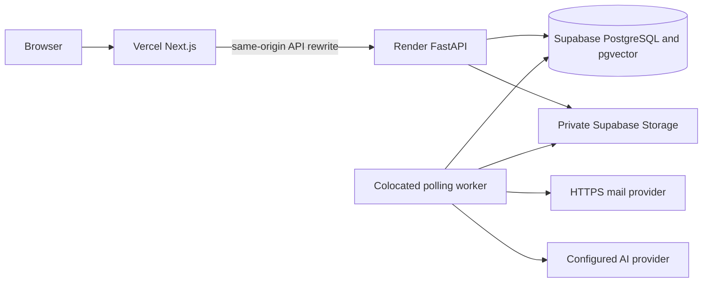

# Cloud operations: Render, Vercel and Supabase

[Operations](README.md) · [Release procedure](deployment.md) · [Topology setup](../migration/render-vercel-supabase.md)

## Recorded resources and evidence

Repository deployment records report production deployment on **2026-11-08**. This runbook synchronizes those records with committed source/configuration; it does not freshly inspect hosted settings, account plans, health, data contents or inbox delivery. Verify intended account/service/revision before an operational change.

| Component | Recorded resource | Recorded location / endpoint |
| --- | --- | --- |
| Frontend | Vercel `planner-t1` | `https://planner-t1.vercel.app` |
| API / polling worker | Render `planner-api-sg` | Singapore; `https://planner-api-sg.onrender.com` |
| PostgreSQL / pgvector | Supabase project `mybfctyrtdjrrmndfdvf` | Mumbai; private application schema `planner` |
| Private files | Supabase Storage `planner-private` | Authenticated API byte proxy, no public object URLs |
| Account mail | Resend HTTPS adapter | Server-configured approved sender/key |



[render.yaml](../../render.yaml) requests service name `planner-api`, branch **`main`**, Singapore, Free plan, `/ready` health check and **`autoDeployTrigger: "off"`**. The recorded existing service name differs from the template name; review/update the intended existing service rather than accidentally provisioning a duplicate. A push to `main` alone does not imply a Render deployment. Actual dashboard settings require separate inspection.

## Configuration

[Settings](../../apps/api/planner/config.py) and [environment example](../../apps/api/.env.example) are authoritative for accepted fields/defaults. Supply secrets through the provider's private environment/secret controls, never committed files, browser variables, command arguments or logs.

| Backend setting | Active topology requirement |
| --- | --- |
| `PLANNER_ENVIRONMENT` | `production` |
| `PLANNER_WEB_ORIGIN` | Exact stable frontend HTTPS origin, recorded `https://planner-t1.vercel.app`; no wildcard previews |
| `PLANNER_DATABASE_URL` | Actual Supabase PostgreSQL session-pooler URL with TLS; use private operator value |
| `PLANNER_DATABASE_SCHEMA` | `planner`, kept outside anonymous Data API exposure |
| `PLANNER_POOL_SIZE` / `PLANNER_POOL_OVERFLOW` | Blueprint `4` / `2` per process; API + worker can use **12** application connections total, plus migration/admin headroom |
| `PLANNER_SUPABASE_URL` | Exact project HTTPS origin |
| `PLANNER_SUPABASE_SERVICE_ROLE_KEY` | Server-only legacy service-role JWT accepted by the current validator |
| `PLANNER_SUPABASE_STORAGE_BUCKET` | Private `planner-private` bucket |
| `PLANNER_WORKER_MODE` / `PLANNER_RUN_WORKER` | `poll` / `true` for colocated worker |
| `PLANNER_MIGRATE_ON_START` | `true` in the single-container blueprint |
| `PLANNER_ENCRYPTION_KEY` | Stable private Fernet key or supported random secret of at least 32 characters; retain for TOTP decryption |
| `PLANNER_SMTP_FROM` / `PLANNER_RESEND_API_KEY` | Approved sender plus HTTPS email credential; template sender is onboarding@resend.dev, which is not proof of general delivery acceptance |
| AI settings | Optional compatible base URL/key/chat+embedding models; configure prices/limits explicitly |

Vercel links **only `apps/web`**, uses Node 22/npm and sets server-only `API_ORIGIN` to `https://planner-api-sg.onrender.com` at build/runtime. Next.js rewrites are built with the destination; a changed origin needs a rebuild. Keep database/storage/mail/provider/encryption keys on the backend. Production does not accept development origin exceptions.

## Release and startup

Follow [deployment](deployment.md): checks, consistent backups, compatible migration review, manually deploy the intended `main` revision, web rebuild with matching origins and acceptance checks. The helper below prints a plan without publishing:

```bash
python3 tools/deploy/planner_v1.py vercel --origin https://planner-t1.vercel.app --backend https://planner-api-sg.onrender.com
```

`--execute` invokes the Vercel CLI against its linked project/account; use only as part of an authorized release. It does not configure Render/Supabase. Do not paste long-lived tokens into shell command arguments.

The container runs `python -m planner.serve`. Optional `alembic upgrade head` completes first; then the supervisor starts API and polling worker. Child exit stops its sibling and exits the container. Sleep pauses both processes; database jobs remain durable. A multi-replica rollout requires a controlled migration strategy instead of competing startup migrations.

## Health and diagnosis

Read-only commands from the repository root:

```bash
python3 tools/deploy/planner_v1.py check --url https://planner-t1.vercel.app
curl --fail --silent --show-error https://planner-api-sg.onrender.com/ready
curl --fail --silent --show-error https://planner-api-sg.onrender.com/health
```

Expected API bodies from source are `{"status":"ready"}` for `/ready` and `/api/v1/health`, `{"status":"ok"}` for `/health` and root GET/HEAD (HEAD has no body). These are expected contracts, not freshly observed responses. Readiness checks DB connectivity, not private storage, mail receipt, AI quality, schema parity or worker progress.

| Symptom | Checks |
| --- | --- |
| 403 on writes | Exact browser Origin, backend `PLANNER_WEB_ORIGIN`, session/CSRF and email-verification state |
| Initial timeout/502/504 | Recorded Free sleep/cold-start behavior, upstream logs/readiness, actual provider proxy limits; do not promise a fixed wake time |
| Jobs stay queued/dead | Worker process, lease/error codes, sleep, provider settings and category preferences; inspect without dumping payloads |
| Pool exhaustion | Both process pools, connection leaks/waits, Supabase connection mode/project capacity; migrations/admin require headroom |
| Private file failure | Bucket privacy, backend service key, object existence and owner/share/password authorization |
| Mail missing | HTTPS provider result/approved sender/recipient restrictions and queued job outcome; no token-log/outbox fallback |
| Startup crash | Production config diagnostics, schema/migration compatibility and child-process exit reason |

## Roles, data and recovery

After verifying the intended database/schema and existing account, an authorized server operator runs from `apps/api`:

```bash
uv run python -m planner.admin person@example.com admin
```

Use `user` to revoke. Both changes write an audit record; no HTTP role-grant endpoint exists. Configure private environment variables before running; do not include DSNs in the command line.

The [cloud COPY helper](../../tools/deploy/migrate_to_supabase.py) copies a fixed table list in one destination transaction and compares counts. It does **not** transfer object bytes, implement incremental merge/idempotency, validate a complete schema/table inventory, reconcile all owner/graph/content checksums or rehearse restoration. It is not a supported general synchronization/backup procedure (ISSUE-065). Further transfer requires separate review, isolated rehearsal and consistent DB+file backups. The guarded legacy importer has different target restrictions and cannot be pointed at cloud data as a workaround.

Confirm current service-plan limits in the provider dashboards before changes. The recorded Free design may sleep/restart and has non-durable container storage; uploads belong in private object storage and background timeliness cannot be guaranteed. Quotas, connection limits, mail sender restrictions, billing and PITR/backup availability are account/plan-dependent. No paid-tier recovery guarantee follows from this runbook. Managed restore, historical reconciliation, provider quality/cost and realistic capacity remain ISSUE-045–048.

## Task Note conversion (revision 0006)

Before upgrading a populated environment, pause writes and retain a private database backup. Revision `0006` creates canonical linked Notes for nonempty legacy Task working text, reuses a same-owner/task Note with identical content, and preserves different linked Notes, timestamps and archive state. It retains the old text column for preservation; the current API no longer reads/writes it. Forward migration changes apply transactionally. Downgrade intentionally does not delete converted Notes, which may already contain new user edits. After deployment, verify a migrated Task Note through both Task and Notes, including a locked Note; the dated verification below records whether this conversion has run on cloud.

### 2026-11-09 Notes release verification

Runtime commit `4a280e1` was deployed to Render (`dep-dboktjff3r2c73bgaco0`, live) and Vercel (`dpl_CUhY87NKS47jw5Fvsk4xQA8t4N5n`, READY), with the stable production alias retained. Render automatic deploys were disabled to match the manual-release blueprint. The API was suspended for a consistent private schema backup before rollout. Revision `0006` was confirmed on `postgres` / `planner`: Task count remained 186, Notes increased from 12 to 118, and all 106 nonempty legacy Task working bodies had a matching same-owner/task canonical Note afterward. No cross-owner Task/Note link was found. The private backup is retained outside Git.

Production login and proxied readiness returned HTTP 200; authenticated demo login and snapshot reads succeeded. A Playwright production browser check opened a migrated Note from its Task, observed the shared formatting toolbar and disabled Save on the clean document, then closed back to the originating Task Notes tab. These release checks do not certify mail delivery, AI quality or managed restore/PITR.
