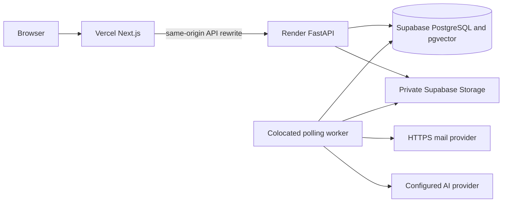

# Cloud operations: Render, Vercel and Supabase

[Operations](README.md) · [Release procedure](deployment.md) · [Topology setup](../migration/render-vercel-supabase.md)

### 2026-11-11 compact Dashboard header

Frontend deployment `dpl_Fmw83krTpuHQ8VSuZiAwA2YrhoHz` reached READY and was assigned `planner-t1.vercel.app`. It was built from tracked frontend files in the local working tree based on `fda5e93`, including uncommitted Dashboard header changes; it is not a Git commit deployment. No backend or database changes were made. The login page and proxied health returned HTTP 200. The hosted synthetic preview was checked at 320, 390 and 1280 px: the compact strip appeared at narrow widths, the calendar appeared at 1280 px and document width did not overflow. These checks do not establish authenticated or physical-device behavior.

Frontend deployment `dpl_FSL7bJqjhtPYUa3vhP3GTgsbGCkP` superseded it, changing the compact strip to the seven days of the current week. The hosted synthetic preview at 320 px displayed seven cells without horizontal page overflow. This deployment also used the uncommitted frontend working tree; no backend or database changes were made.

Frontend deployment `dpl_HnVsPfEg6RmaXs762qh7HFf5kWzm` superseded it, hiding the redundant Activity heading on narrow screens. The hosted synthetic preview at 320 px showed seven cells without the heading or horizontal page overflow. It used the uncommitted frontend working tree and made no backend or database changes.

Frontend deployment `dpl_EvY6hJDY4Pyccyf6ZGP1ikBssGgr` superseded it and removed the compact strip's “This week” text. The frontend build passed. It used the uncommitted frontend working tree and made no backend or database changes.

Frontend deployment `dpl_H3UALXHgoEtJvwbDeVQq6ujLy1tq` reached READY and was assigned `planner-t1.vercel.app` for the all-day Task Calendar frontend. It used the uncommitted frontend working tree; the backend and database were not changed. Local frontend verification passed TypeScript, 47 unit tests, the production and E2E builds, and the focused Calendar capture browser test on desktop/mobile against isolated `planner_test`. A hosted synthetic mobile preview at 390 px showed two date inputs, no timed schedule or estimate controls, and no horizontal page overflow. No authenticated production Task mutation or database migration was performed.

Frontend deployment `dpl_9ZwZ9tUgJD9DBi65Z9MmoTFKmVf2` reached READY and was assigned `planner-t1.vercel.app` for separate Notes Add tag and Manage tags actions. It used the uncommitted tracked frontend working tree. Local TypeScript, 47 frontend unit tests, production build and documentation checks passed. The hosted synthetic Notes preview showed a one-field Add tag dialog and a separate Manage tags dialog with existing tags only. The authenticated browser test was added but not run because Docker/`planner_test` was unavailable in the WSL environment; no production Note mutation was performed.

Frontend deployment `dpl_B2W3pqGK6jxJNHNLoXuqHZxZJUJX` reached READY and was assigned `planner-t1.vercel.app` for the Dashboard Task checklist completion-control move. It used the uncommitted tracked frontend working tree. TypeScript, production build and documentation checks passed; the local synthetic Dashboard preview was checked in Daily and Weekly at 390 px, and the hosted preview showed the completion control at the right edge with a 44 px hit area. No authenticated production Task mutation was performed.

## Recorded resources and evidence

The API deployment on **2026-11-12** uses commit `838fed3`, Render deploy `dep-dbqh6r2jnfac738mdlug`, and Vercel `planner-t1`. The database was moved to Singapore as recorded below. Verify current hosted settings, health and account plans before an operational change.

| Component | Recorded resource | Recorded location / endpoint |
| --- | --- | --- |
| Frontend | Vercel `planner-t1` | `https://planner-t1.vercel.app` |
| API / polling worker | Render `planner-api-sg` | Singapore; `https://planner-api-sg.onrender.com` |
| PostgreSQL / pgvector | Supabase project `brmmkaunlnjxmsbfvrsf` | Singapore; private application schema `planner` |
| Private files | Supabase Storage `planner-private` | Authenticated API byte proxy, no public object URLs |
| Account mail | Resend HTTPS adapter | Server-configured approved sender/key |



[render.yaml](../../render.yaml) requests service name `planner-api`, branch **`main`**, Singapore, Free plan, `/ready` health check and **`autoDeployTrigger: "off"`**. The recorded existing service name differs from the template name; review/update the intended existing service rather than accidentally provisioning a duplicate. A push to `main` alone does not imply a Render deployment. Actual dashboard settings require separate inspection.

### Backend release verification (2026-11-12)

Commit `838fed3` was deployed as Render `dep-dbqh6r2jnfac738mdlug` after both GitHub workflows passed: 212 API tests passed with one baseline-history test skipped, 47 web tests passed, and 102 browser tests passed. Local API verification passed all 213 tests. A fresh encrypted backup and isolated restore succeeded before release. Production inspection confirmed schema `0012`, 31 application tables, four new indexes and fresh scheduler/fast/slow heartbeats. Five inspected post-release readiness probes returned 200 with 14 ms server durations; no error event appeared in that inspected log window. This does not establish sustained capacity or complete hosted user-flow acceptance.

The stored scheduler mode remains `legacy`. No checkpoint backfill, compare/due switch, frontend flag activation or production job cleanup was performed. The cleanup timer remains disabled; backup and isolated restore timers remain active. Rolling back to an image unaware of revision `0012` requires disabling its startup migrations; do not run destructive downgrades. Prefer this compatible image in legacy scheduler mode while investigating.

### Direct due-mode activation (2026-11-12)

The owner explicitly waived shadow comparison and its 24-hour trial. The operator verified the Singapore `postgres/planner` identity and revision `0012`, backfilled one active series checkpoint under owner locks, and switched the shared scheduler mode from `legacy` to `due` without comparison. A subsequent live tick recorded due mode, fresh scheduler/fast/slow heartbeats and no pending legacy periodic work. No job cleanup or frontend deployment was performed; the cleanup timer remains disabled. The usual comparison gate described in the runbook was deliberately bypassed for this owner-authorized transition, not reported as passed.

## Configuration

[Settings](../../apps/api/planner/config.py) and [environment example](../../apps/api/.env.example) are authoritative for accepted fields/defaults. Supply secrets through the provider's private environment/secret controls, never committed files, browser variables, command arguments or logs.

| Backend setting | Active topology requirement |
| --- | --- |
| `PLANNER_ENVIRONMENT` | `production` |
| `PLANNER_WEB_ORIGIN` | Exact stable frontend HTTPS origin, recorded `https://planner-t1.vercel.app`; no wildcard previews |
| `PLANNER_DATABASE_URL` | Actual Supabase PostgreSQL session-pooler URL with TLS; use private operator value |
| `PLANNER_DATABASE_SCHEMA` | `planner`, kept outside anonymous Data API exposure |
| `PLANNER_POOL_SIZE` / `PLANNER_POOL_OVERFLOW` | Blueprint `4` / `2` per process; API + worker can use **12** application connections total, plus migration/admin headroom |
| `PLANNER_SUPABASE_URL` | Exact project HTTPS origin |
| `PLANNER_SUPABASE_SERVICE_ROLE_KEY` | Server-only legacy service-role JWT accepted by the current validator |
| `PLANNER_SUPABASE_STORAGE_BUCKET` | Private `planner-private` bucket |
| `PLANNER_WORKER_MODE` / `PLANNER_RUN_WORKER` | `poll` / `true` for colocated worker |
| `PLANNER_MIGRATE_ON_START` | `true` in the single-container blueprint |
| `PLANNER_ENCRYPTION_KEY` | Stable private Fernet key or supported random secret of at least 32 characters; retain for TOTP decryption |
| `PLANNER_SMTP_FROM` / `PLANNER_RESEND_API_KEY` | Approved sender plus HTTPS email credential; template sender is onboarding@resend.dev, which is not proof of general delivery acceptance |
| AI settings | Optional compatible base URL/key/chat+embedding models; configure prices/limits explicitly |

Vercel links **only `apps/web`**, uses Node 22/npm and sets server-only `API_ORIGIN` to `https://planner-api-sg.onrender.com` at build/runtime. Next.js rewrites are built with the destination; a changed origin needs a rebuild. Keep database/storage/mail/provider/encryption keys on the backend. Production does not accept development origin exceptions.

## Release and startup

Follow [deployment](deployment.md): checks, consistent backups, compatible migration review, manually deploy the intended `main` revision, web rebuild with matching origins and acceptance checks. The helper below prints a plan without publishing:

```bash
python3 tools/deploy/planner_v1.py vercel --origin https://planner-t1.vercel.app --backend https://planner-api-sg.onrender.com
```

`--execute` invokes the Vercel CLI against its linked project/account; use only as part of an authorized release. It does not configure Render/Supabase. Do not paste long-lived tokens into shell command arguments.

The container runs `python -m planner.serve`. Optional `alembic upgrade head` completes first; then the supervisor starts API and polling worker. Child exit stops its sibling and exits the container. Sleep pauses both processes; database jobs remain durable. A multi-replica rollout requires a controlled migration strategy instead of competing startup migrations.

## Health and diagnosis

Read-only commands from the repository root:

```bash
python3 tools/deploy/planner_v1.py check --url https://planner-t1.vercel.app
curl --fail --silent --show-error https://planner-api-sg.onrender.com/ready
curl --fail --silent --show-error https://planner-api-sg.onrender.com/health
```

Expected API bodies from source are `{"status":"ready"}` for `/ready` and `/api/v1/health`, `{"status":"ok"}` for `/health` and root GET/HEAD (HEAD has no body). These are expected contracts, not freshly observed responses. Readiness checks DB connectivity, not private storage, mail receipt, AI quality, schema parity or worker progress.

| Symptom | Checks |
| --- | --- |
| 403 on writes | Exact browser Origin, backend `PLANNER_WEB_ORIGIN`, session/CSRF and email-verification state |
| Initial timeout/502/504 | Recorded Free sleep/cold-start behavior, upstream logs/readiness, actual provider proxy limits; do not promise a fixed wake time |
| Jobs stay queued/dead | Worker process, lease/error codes, sleep, provider settings and category preferences; inspect without dumping payloads |
| Pool exhaustion | Both process pools, connection leaks/waits, Supabase connection mode/project capacity; migrations/admin require headroom |
| Private file failure | Bucket privacy, backend service key, object existence and owner/share/password authorization |
| Mail missing | HTTPS provider result/approved sender/recipient restrictions and queued job outcome; no token-log/outbox fallback |
| Startup crash | Production config diagnostics, schema/migration compatibility and child-process exit reason |

## Roles, data and recovery

After verifying the intended database/schema and existing account, an authorized server operator runs from `apps/api`:

```bash
uv run python -m planner.admin person@example.com admin
```

Use `user` to revoke. Both changes write an audit record; no HTTP role-grant endpoint exists. Configure private environment variables before running; do not include DSNs in the command line.

The [cloud COPY helper](../../tools/deploy/migrate_to_supabase.py) copies a fixed table list in one destination transaction and compares counts. It does **not** transfer object bytes, implement incremental merge/idempotency, validate a complete schema/table inventory, reconcile all owner/graph/content checksums or rehearse restoration. It is not a supported general synchronization/backup procedure (ISSUE-065). Further transfer requires separate review, isolated rehearsal and consistent DB+file backups. The guarded legacy importer has different target restrictions and cannot be pointed at cloud data as a workaround.

### Singapore database move (2026-11-11)

The previously active Mumbai project `mybfctyrtdjrrmndfdvf` was copied to Singapore project `brmmkaunlnjxmsbfvrsf`. With the API and worker suspended, an encrypted `planner` schema archive was created and restored; all 31 table counts and row-content digests matched, and the source remained unchanged during verification. Both Supabase Auth and Storage contained zero records/objects at cutover. The destination has a private `planner-private` bucket and revision `0009`. The existing API image was deployed with the new connection and service role; Render's internal `/ready` probe returned 200 and the bucket was accessible using the destination server credential. Browser login, private file transfer, mail, AI and background job execution were not independently tested.

The former source is retained with `default_transaction_read_only` enabled for its `postgres` role, preventing the resumed old deployment from writing during cutover. That setting is a safeguard, not a substitute for access control or reconciliation. Do not resume writing to the old database as a rollback: any writes made in Singapore after cutover must first be reconciled. The final encrypted schema archive and its separately stored key file are retained locally outside Git under `/home/thanhdat/.local/share/planner-backups/singapore-rehearsal-z1dpd37b/`; both files reside in the same restricted directory and do not constitute an independent disaster-recovery backup. The Free plan was confirmed by the project owner; organization billing access was unavailable to the operator token.

An additional local [backup tool](../../tools/backup/planner_backup.py) snapshots the application schema and private bucket with an exported repeatable-read PostgreSQL snapshot, checks referenced Note attachment checksums, encrypts database/object files and the manifest, validates the database archive, and retains seven daily and four weekly versions. It stops if Supabase Auth users appear, a referenced object is missing, or disk space is insufficient. The user-level `planner-backup.timer` is enabled for 03:10 Asia/Ho_Chi_Minh with missed runs caught up when the user service manager is available; Docker, network, local credentials and this checkout must also be available. The monthly `planner-restore-drill.timer` restores only into a temporary `planner_test` container. A successful timer service and isolated restore with all 31 table counts and row digests matching the snapshot were observed; the tested bucket contained no objects. `planner-job-cleanup.timer` was configured but is disabled while rollout is paused; when explicitly resumed, it checks the 48-hour stability and fresh-heartbeat gates before creating a new backup and deleting a bounded batch. Production has not switched scheduler modes. Backups and the decryption key are in separate directories on the same machine, not an independent off-site copy. Check `systemctl --user status planner-backup.timer planner-backup.service` and the most recent backup before relying on recovery.

Confirm current service-plan limits in the provider dashboards before changes. The recorded Free design may sleep/restart and has non-durable container storage; uploads belong in private object storage and background timeliness cannot be guaranteed. Quotas, connection limits, mail sender restrictions, billing and PITR/backup availability are account/plan-dependent. No paid-tier recovery guarantee follows from this runbook. Managed restore, historical reconciliation, provider quality/cost and realistic capacity remain ISSUE-045–048.

## Task Note conversion (revision 0006)

Before upgrading a populated environment, pause writes and retain a private database backup. Revision `0006` creates canonical linked Notes for nonempty legacy Task working text, reuses a same-owner/task Note with identical content, and preserves different linked Notes, timestamps and archive state. It retains the old text column for preservation; the current API no longer reads/writes it. Forward migration changes apply transactionally. Downgrade intentionally does not delete converted Notes, which may already contain new user edits. After deployment, verify a migrated Task Note through both Task and Notes, including a locked Note; the dated verification below records whether this conversion has run on cloud.

### 2026-11-09 Notes release verification

Runtime commit `4a280e1` was deployed to Render (`dep-dboktjff3r2c73bgaco0`, live) and Vercel (`dpl_CUhY87NKS47jw5Fvsk4xQA8t4N5n`, READY), with the stable production alias retained. Render automatic deploys were disabled to match the manual-release blueprint. The API was suspended for a consistent private schema backup before rollout. Revision `0006` was confirmed on `postgres` / `planner`: Task count remained 186, Notes increased from 12 to 118, and all 106 nonempty legacy Task working bodies had a matching same-owner/task canonical Note afterward. No cross-owner Task/Note link was found. The private backup is retained outside Git.

Production login and proxied readiness returned HTTP 200; authenticated demo login and snapshot reads succeeded. A Playwright production browser check opened a migrated Note from its Task, observed the shared formatting toolbar and disabled Save on the clean document, then closed back to the originating Task Notes tab. These release checks do not certify mail delivery, AI quality or managed restore/PITR.

### Area name migration (0008)

Revision `0008` was applied in the backend release recorded below. For other environments, back up the intended database and rehearse on an isolated restored copy before upgrading. It adds a unique index per owner over `lower(btrim(regexp_replace(title, '\s+', ' ', 'g')))`, including archived Areas. Service writes use the same PostgreSQL normalization. Existing titles are preserved.

The migration checks duplicates before changing schema. If found, it aborts with owner and Area IDs; let the owner choose new names, then retry. Never merge, delete or automatically rename their data to force an upgrade. Read-only preflight query (run against the explicitly selected database/schema):

```sql
SELECT user_id, array_agg(id ORDER BY id) AS area_ids
FROM areas
GROUP BY user_id, lower(btrim(regexp_replace(title, '\s+', ' ', 'g')))
HAVING count(*) > 1;
```

Local `planner_dev/public` had no duplicate groups; it was backed up privately and upgraded to `0008`, preserving 13 Areas, 120 Notes and 157 Tasks. This is a local migration/count check, not hosted acceptance or a restore rehearsal.

### Task Note cardinality migration (0007)

Revision `0007` was applied with `0008` in the backend release recorded below; it was absent from the earlier `4a280e1` release. Back up the intended database before applying it elsewhere. It retains one attached Note per Task, preferring active Notes, then a match to legacy working text, then creation time/ID. Other Notes become independent resource references in the Task details; their content, locks, documents and attachments remain intact. A unique constraint prevents multiple attached Notes. Downgrade removes the constraint but preserves resource links instead of copying content back.

### 2026-11-09 shared UI release — backend and frontend deployed

Application commit `c0f4f2a` was pushed to `main` and the working branch. Render deployment `dep-dboseg8u01pc7389f3c0` reached `live` at 13:16 UTC on 2026-11-09 with that exact commit. Automatic Render deployment remains disabled. The API was briefly suspended for a final consistent private backup and resumed before the manual deployment.

The private schema backup contained 31 tables and zero referenced/private-bucket objects. It was restored only into isolated local `planner_test/planner`; all restored table counts and deterministic row digests matched the source snapshot. Rehearsing revisions `0007` and `0008` preserved the digests/counts of all 30 business tables and found no cross-owner Task/Note links. The restored production schema was removed afterward. This is a specific schema-backup restoration rehearsal, not a managed PITR or complete historical migration acceptance claim.

Cloud revision is now `0008`, with 16 Areas, 186 Tasks and 118 Notes preserved, no duplicate normalized Area-name groups and no multiple attached Task Note groups. Local release checks passed 175 API tests, 38 web unit tests, the production frontend build with the hosted API origin, Ruff and the documentation checker/17 documentation tests.

After rollout, the API readiness endpoint, production login page and same-origin proxied health returned HTTP 200. The existing synthetic demo account logged in and read its workspace snapshot successfully; the smoke session logged out with HTTP 204. No planning/Note mutation, email delivery or AI-provider evaluation was performed.

The initial Vercel token had expired; a renewed private token restored access to the existing `planner-t1` project. Its ID and production aliases were verified; the local project's stale name was corrected without creating a new project. Vercel deployment `dpl_5wZT9JRHAc4HqqhJdoXNKZkmgEEv` reached `READY` at 13:25 UTC, with `planner-t1.vercel.app` assigned successfully. It contains only tracked frontend files from `0fc01f6`, whose frontend source matches application commit `c0f4f2a`; private environment/credential files were excluded. The hosted Render API origin was supplied for both build and runtime.

Post-release login, authenticated demo workspace reads, logout and proxied readiness succeeded again. A browser loaded the authenticated Dashboard. Responsive geometry assertions on the hosted synthetic Dashboard preview passed at 1440, 390 and 320 px: roadmap columns shared equal widths on one row without horizontal overflow. This preview check uses synthetic data, not mutations of hosted user records. The GitHub application workflow for `c0f4f2a` also completed successfully. These checks do not certify mail delivery, AI-provider quality or complete human acceptance.

### Task completion migration (0009)

Revision `0009` was applied in the binary Task release recorded below; it was absent from the earlier shared UI release. It converts Task `doing`/`blocked` rows and repeating Task template states to `todo`, retains `done`, and adds a database check allowing only `todo`/`done`. Content, checklist, relationships, completion timestamps, versions and existing search/index-job versions remain intact; this normalization changes representation of open work without fabricating completion activity. Goal/Milestone statuses are unchanged. The API rejects the removed Task states, including in recurring templates; the frontend maps any older open Task state to Not completed.

Before rollout, take a verified private backup and rehearse on an isolated restored copy. Pause old writers during the coordinated API/frontend migration; an old client submitting removed Task states must refresh to the new frontend. Implementation tests used only guarded `planner_test`; the subsequent hosted migration is recorded below. Downgrade broadens allowed values but deliberately does not invent previous open states.

### 2026-11-09 binary Task, Calendar and mobile-input release

Application commit `994669b` was pushed to `main` and the working branch. Vercel deployment `dpl_6ttVoBPJb6hYPE8kfqkTqCFTaKt8` reached `READY` with `planner-t1.vercel.app` assigned; Render deployment `dep-dbotbrijnfac73fvqjjg` reached `live` at 14:19 UTC with the same application commit. The frontend was published first because its two-state mapping remains compatible with the old API, then the API was briefly suspended for a consistent final backup and resumed for the manual backend rollout. Render automatic deployment remains off. An initial Vercel file-upload HTTP 500 was recovered by uploading the remaining missing blob; it did not create a duplicate deployment.

The final private backup contained 31 tables and zero private objects. An isolated local restore matched every source table count/digest. Rehearsing `0008` → `0009` changed only 15 old doing/blocked Task states to todo; no repeating templates needed normalization. The private restored schema was then removed. Hosted verification found revision `0009`, 186 Tasks (110 done, 76 todo), 16 Areas and 118 Notes. Task and repeating-template row digests matched the exact rehearsed result, including content, relationships, versions and timestamps; the binary database constraint was present. This is a specific schema backup/restore rehearsal, not managed PITR acceptance.

Hosted synthetic browser checks verified exactly two Task filter states plus All, 16 px mobile search/select controls, a full-width Calendar without the two sidebar cards, and direct picker toggle accessibility at 1440/390 px. Login, authenticated demo workspace reads (with only todo/done Tasks), logout and proxied readiness succeeded. Local checks passed 178 API tests, 39 frontend unit tests, the frontend production build, Ruff and the documentation checker/17 documentation tests; the final migration-specific regression run also passed. No hosted Task CRUD smoke mutation was performed beyond the authorized migration. Actual iOS keyboard show/dismiss behavior still requires a physical-device check; font/viewport emulation does not certify it.

### 2026-11-09 Milestone header release

Frontend application commit `1bd158d` was deployed as Vercel `dpl_EvXT7ezhLbkM6hDwjxvLM3G7Stih` (READY, stable `planner-t1.vercel.app` alias assigned). This frontend-only release fixes clipped Milestone action menus and responsive title/action wrapping. Render remains on `994669b`; no database migration or hosted planning mutation was needed.

A production browser verified both Milestone menu actions remain within the viewport and receive pointer hits at 1440/390 px, and Edit milestone opens its dialog. Local geometry checks additionally covered 768/320 px; illustrated headers retained 16 px corners/background clipping. The production login page and proxied health returned HTTP 200.

The earlier application CI run for `994669b` finished with 100 browser cases passing and two failures: the same floating-actions test on desktop/mobile still expected Calendar's retired Page actions menu. Coverage now uses Calendar's direct shared-picker toggle. The corrected focused suite passed all four desktop/mobile cases locally on isolated `planner_test`; the E2E build also passed. The subsequent full GitHub Actions run for `1c58be7`, [42636509761](https://github.com/datphan3201/Planner-T1/actions/runs/42636509761), completed successfully: 178 API tests, 39 frontend unit tests, both frontend builds and all 102 desktop/mobile browser cases passed. The earlier failed runs belong to commits before the Calendar test correction; they remain historical failures, not the current application verification result.

### 2026-11-09 Task action labels and themed importance

Frontend commit `5829946` was deployed as Vercel `dpl_F1oUCvbtWPGVYTi8nKVwAhyzqfv8` (READY, stable `planner-t1.vercel.app` alias assigned). Task rows now show labeled This week, Today and Actions controls, explicit selected checkmarks, an importance label/value and wrapping controls beneath Task text. Task rows use explicit plan selections consistently with detail/picker controls, including date-derived Today membership. Completed Tasks disable plan changes. Shared importance rendering and the `--importance-color` accent token cover Task, planning and Habit controls and retained alternate star renderers. The backend and schema were unchanged.

Production synthetic browser checks verified labels, importance values and menu viewport bounds at 1440/390/320 px; star colors matched the theme accent in light/dark. Local checks also covered all five scenery themes, Goal/Habit stars, editable importance and Today/week toggle invariants. The production login page and proxied health returned HTTP 200. The production build, 39 frontend unit checks, documentation integrity and its 17 regression tests passed locally. No hosted planning records were changed by these checks; full CI for this commit is a separate run.

### 2026-11-09 desktop Task action alignment

Frontend commit `5439602` was deployed as Vercel `dpl_CecpNSTTcToXEZPBsYu45tQbSXmf` (READY, production alias assigned). Wide desktop Task actions are again inline on the right; compact/mobile layouts retain wrapping. Local checks covered 1440/1280/1024/390/320 px without horizontal overflow; production checks confirmed inline right-side actions at 1440/1280 px and a separate mobile row at 390 px. The production build passed. The backend/schema were unchanged.

### 2026-11-09 UTC+7 application defaults

Application commit `2d4f138` was deployed to Render (`dep-dboumbajnfac73836g60`, live) and Vercel (`dpl_3cz2GeknDVrAMWM1ntDCCYsJx2J3`, READY, production alias assigned). API/frontend share an explicit UTC+7 default (`Asia/Ho_Chi_Minh`) for accounts, Habits, recurrence and missing-configuration fallbacks. Task schedule labels follow the account timezone. Previously selected account/entity timezones remain authoritative; no existing account/check-in/history timestamps were rewritten. UTC instant storage/logging and DATE semantics remain unchanged.

A fresh private 31-table schema backup with zero private objects was restored into isolated `planner_test`; revision `0009` required no upgrade and row counts/digests matched. The private restored schema was removed. The code-only release required no database or account-data migration. Local checks passed 179 API tests, 41 frontend unit tests, the production build, Ruff and documentation checks/17 documentation tests. Tests covered the UTC+7 midnight boundary and preservation of explicit UTC choices. The hosted synthetic profile preview selected `Asia/Ho_Chi_Minh`; it is not evidence of creating a production account or testing mail delivery.

Post-deployment login, authenticated demo snapshot reads, logout and proxied health succeeded. No hosted planning/profile mutation was performed by the smoke checks.
