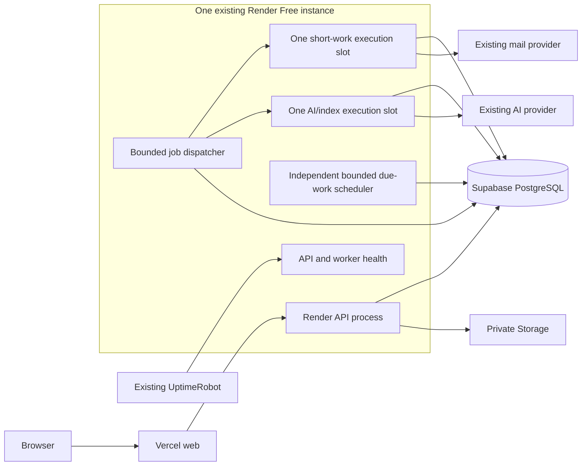

# Free-tier backend optimization plan

[Operations](README.md) · [Cloud operations](cloud.md) · [Jobs](jobs.md) · [Open issues](../issues.md)

Status: proposed implementation plan, 2026-11-11. This document does not authorize or report a production deployment, data deletion, provider-plan change, or completed test run. The user requires zero cloud-infrastructure spending and already uses UptimeRobot. Karpathy Guidelines govern implementation: deliver small, measurable changes and preserve existing domain behavior.

The working tree contains a feature-gated indexed due-work scheduler, recurrence checkpoints, bounded worker lanes, worker heartbeats, buffered AI output, nonblocking SSE reads and owner-scoped Activity/Archive pagination endpoints. Migrations `0010`–`0012` and these application changes have not been deployed; the frontend still uses the full workspace snapshot. A local encrypted backup timer has been enabled and a database restore rehearsed; production memory verification, complete bounded workspace/frontend reads, scheduler transition and observation, and legacy-job cleanup remain outstanding. In isolated testing, ten idle simulated minutes with eight accounts produced 168 scheduler rows on deployed baseline `6094212` and zero in due mode. A separate synthetic 200 ms database wait measured a 50 ms event-loop timer firing at a mean 200.4 ms on baseline and 50.8 ms with the working-tree SSE change, over three samples each; neither is a hosted latency measurement.

The optional frontend Activity path now uses date summaries and paginated day details behind `NEXT_PUBLIC_BOUNDED_ACTIVITY=true`; other workspace entities still use a full snapshot, including Archive. An isolated 50,000-Activity fixture measured 7,051,225 bytes / 816.9 ms for the full snapshot versus 1,345 bytes / 51.2 ms for the Activity-summary snapshot and 14,160 bytes / 13.5 ms for 100 Activity rows. In the same fixture, the slowest of five simultaneous reads was 3,605.2 ms for the full snapshot and 111.4 ms for the summary path. These are local samples from one synthetic account, not a production p95 or hosted result. A local 10 MiB private-file read allocated a peak 10,490,833 Python bytes with full buffering versus 136,988 bytes when consuming the new stream; provider concurrency and production memory remain to be measured. Before release, production aggregates showed 74,472 jobs, including 22,016 periodic jobs with availability in the preceding 24 hours; the guarded cleanup dry run selected 31,930 completed legacy jobs, but deleted none. Render's preceding-hour memory series peaked at 186,474,500 bytes against a 536,870,900-byte limit, without a representative concurrent load.

## Constraints and evidence

- Retain Vercel web, one Render Free service containing API and worker processes, and Supabase PostgreSQL/private Storage. Retain the existing UptimeRobot arrangement; its monitor settings have not been inspected. Add no paid worker, queue, cache, monitoring service, or database tier. Existing mail/AI usage must remain within separately verified provider allowances.
- The read-only production inspection on 2026-11-11 confirmed Render Singapore, one Free instance, manual deploys, polling worker enabled, startup migration enabled, and a 4+2 database pool per API/worker process. The running backend revision was `6094212`; the backend source inspected in the checkout matched it.
- Supabase was moved from Mumbai to Singapore after this initial inspection. The owner confirmed the Free plan; organization-level entitlement requests returned 403 with the available token, so exact organization quotas remain unverified. Physical disk size is not the subscription's database allowance.
- The inspection found eight unlocked accounts, one active recurring series, seven unfinished Tasks with reminders, approximately 22,112 periodic jobs over the preceding 24 hours, and about 44 MB of `jobs` relation/index space in a 59 MB database. These are dated aggregate observations, not sustained measurements or a forecast.
- The current scheduler creates per-account recurrence/reminder jobs every minute and retention jobs by hour. One worker processes jobs sequentially and runs scheduling in the same loop. Workspace refresh loads complete account data, including archived rows and Activity.
- API/worker logging exists. OTLP export was not configured on the inspected service. Past release-specific backup rehearsals exist; scheduled complete database-plus-object recovery is not established.

Render documents idle sleep, shared free-instance hours and other Free limits. UptimeRobot documents five-minute checks on Free. Accept the provider's availability/restart limits; monitor actual usage rather than promising continuous availability. One service running through a 31-day month consumes about 744 hours before any other workspace services are counted. Sources: [Render Free](https://render.com/docs/free), [UptimeRobot Free](https://help.uptimerobot.com/en/articles/11604710-who-should-use-uptimerobot-s-free-plan).

## Intended design

PostgreSQL remains the durable source of truth and transactional outbox. Scheduling examines indexed due work rather than manufacturing an empty check job per account per minute. The queue represents actual work. Scheduler and dispatch progress independently of a long provider call, while execution concurrency stays small enough for the existing instance.

The diagram describes proposed logical execution roles, not additional cloud services. Provider limits and outages can still delay work; successful restart must reconcile pending work without duplicate domain effects.

## Proposed acceptance budgets

These are initial engineering targets to validate against a measured baseline, not free-tier SLAs. Record failures and adjust scope or justified budgets explicitly; do not weaken expectations silently.

| Concern | Target and measurement |
| --- | --- |
| Idle scheduling | With no work due or state changes, create zero new periodic check-job rows; bound scheduler state by resources, not elapsed minutes |
| Scheduling amplification | At least 95% fewer scheduling-related inserted rows when replaying the same representative workload as the old scheduler |
| Reminder delay | Warm, healthy service: p95 notification creation within 90 seconds of the intended instant in a controlled fixture; measure mail-provider delay separately |
| Idle interactive queue | Warm worker: AI jobs normally begin within 10 seconds when the AI slot is free; record backlog separately |
| API responsiveness | Provisional p95 server duration at most 1 second for ordinary reads/writes with five concurrent active users on a defined representative dataset |
| Resource use | No OOM, pool exhaustion, unbounded thread creation or sustained queue growth in the acceptance run; stay below 80% of the actual instance memory limit during that run |
| Read growth | Archive/Activity pagination prevents bootstrap size from growing in proportion to all historical rows; record bytes, queries and duration per route |
| Domain correctness | Zero duplicate reminder notifications/emails or recurring occurrences in retry, restart and mixed-version tests |
| Recovery | Daily encrypted backups and a rehearsed two-hour restore are proposed goals, conditional on a reliable free backup runner and available local storage |

Use an isolated `planner_test` fixture containing small ordinary accounts and a larger account with approximately 2,000 Tasks, 1,000 Notes and 50,000 Activity rows. Include long Notes, archived entities, shared/locked Notes, recurrence and timezone boundaries. Confirm fixture size fits the test environment before running it. Production inspection remains read-only except for separately authorized release operations.

## Delivery 0: establish a reproducible baseline

1. Record backend commit, frontend deployment/source state, schema revision, configuration names, region, quotas that can actually be read, connection budgets and backup location. Reconcile existing frontend working-tree deployments into reviewable source before combining later releases with them.
2. Measure idle SQL traffic, inserted jobs by kind, queue age, reminder lateness, request duration, process memory, pool waits, bootstrap bytes and query count. Use aggregate queries and redacted logs; never collect prompts, Note text, tokens or job payloads.
3. Run relevant tests against a verified isolated database. Revalidate stale issue reports against current configuration; for example, the latest inspected backend had AI configured despite the older ISSUE-069 report.
4. Record current performance as evidence, including where measurements come from. A health response is not a performance or worker-health measurement.

Verify: a source/configuration manifest and repeatable baseline commands exist, with dated results and clear measurement limits.

## Delivery 1: replace periodic account fan-out

### Reminder selection

- Run one bounded global due-work selection approximately every 60 seconds, using `Task.reminder_at` as the existing schedule source. Query eligible work before applying a batch limit so disabled, historical or already-notified items cannot starve later eligible items.
- Add an appropriate partial/composite due-work index after checking the actual query plan. Use existing notification keys as delivery receipts initially. Add a separate pending marker only if measured plans show that checking old receipts becomes the next bottleneck.
- Enqueue at most one durable reminder-dispatch job for each actual Task/reminder instant. Its key includes Task identity and the expected reminder instant. Database uniqueness handles repeated selection or overlapping processes.
- The dispatch handler rechecks owner, lock/preferences, current reminder instant, completion/archive state and obsolete-overdue rules. Changed or cleared reminders complete as stale work. A same-instant reopen follows existing notification-deduplication semantics.
- Commit notification creation and email enqueue atomically. Preserve the existing independent email job and provider idempotency identity.
- All creation paths participate through stored Task fields: ordinary edits, workspace batches, AI Apply, recurring materialization and imports. Reading a page never creates recurring Tasks or sends reminders.

### Recurrence and maintenance

- Select active series that need their existing seven-day materialization horizon replenished. Persist a per-series `next_materialize_at` so inactive/far-future series do not require minute-by-minute checks. Recompute it on relevant create/edit/pause/resume/archive/restore operations.
- Calculate checkpoints from the series timezone and recurrence rule. Preserve month-end/leap-day anchoring, cursor semantics and the existing unique occurrence constraint. Use bounded catch-up after downtime.
- Schedule History maintenance with a small persistent checkpoint per maintenance operation, scanning only eligible work in bounded owner-scoped batches. One minute passing must not create another retained maintenance-history row.
- Store successful checkpoint advancement and business writes in the same transaction. Preserve owner authorization, versions, domain validation and atomic graph changes.

### Transition

- Use a temporary scheduler mode switch. Only one scheduler mode generates new work at a time. Keep legacy queued-job handlers available while older rows drain.
- Introduce new schema/indexes additively. Backfill scheduling checkpoints in bounded batches, then run the new selector in read-only comparison mode before enabling its writes.
- Compare selected due Task/series IDs internally without logging their content. Resolve differences in timezone, preferences and catch-up behavior before switching production.

Verify: no-work fixtures create no queue rows; eligible reminders survive edits/restarts without duplicate effects; recurrence preserves local dates; more than a full batch progresses fairly; rollback to the legacy mode remains possible during the transition window.

## Delivery 2: keep scheduling responsive within the same instance

- Separate scheduler timing from synchronous provider execution inside the existing worker process. Use a bounded dispatcher with at most one short-work slot and one AI/index slot initially; each execution owns its database session.
- Claim a job only when its execution slot is available. Keep lease-token checks, retry limits and the current lease duration until long-running/restart tests justify changing it. Make lane selection fair enough that indexing cannot starve indefinitely.
- Make idle queue polling back off to a maximum around five seconds, with bounded sleep until the next scheduler tick. An idle loop should avoid continuous one-second database checks when there is no work.
- Set provider deadlines and bounded catch-up/batch work. Measure memory and pool use before enabling two simultaneous executions; keep the existing aggregate connection ceiling until evidence supports a change.
- Recover an exited worker with bounded supervisor retries while keeping API availability observable. Repeated worker failures must produce an unhealthy worker status rather than an invisible restart loop. Rehearse the final supervisor behavior before rollout.
- Test the alternate authenticated Cloud Tasks delivery path for compatibility if it remains in source. It is not activated or provisioned by this plan.

Verify: a deliberately slow synthetic AI provider does not stop scheduler ticks or timely notification creation; simultaneous retries preserve domain idempotency; process termination resumes pending work; CPU/memory and connection limits remain within the baseline budget.

## Delivery 3: reduce AI and file I/O overhead

- Buffer AI answer fragments and persist at a bounded cadence, initially at most about twice per second, plus first/final/error checkpoints. Flush outstanding content before recording terminal state.
- Batch source-access checks with those checkpoints while preserving the existing policy for locks, sharing changes and unavailable sources. Test revocation during generation; do not trade authorization correctness for fewer queries.
- Keep provider calls outside business transactions. Move synchronous database work in the async SSE route off the event loop, or use a consistently asynchronous database path. Do not migrate the whole API stack merely to repair this route.
- Deliver bounded answer deltas where supported and retain a final-result recovery endpoint. Reconnect must recover complete persisted output without duplicated text or an extra AI run. Compatibility with older clients remains until the frontend release is verified.
- Profile private file transfer memory before changing it. If buffering materially affects the free instance, stream downloads in bounded chunks while preserving authorization and cleanup-on-upload-failure. Keep the current application upload allowance unless separately requested.

Verify: compare database writes per synthetic answer and API responsiveness during streaming; test disconnect/reconnect, partial output, provider errors, lock/share revocation, private-file access and memory use. Use deterministic providers and isolated storage in tests.

## Delivery 4: bound workspace reads and refresh only affected data

- Add a bounded bootstrap containing identity/preferences, route data and server-derived summaries. Provide searchable/paginated reference choices and entity-detail reads for editors. Do not make Goal progress depend on whichever child pages happen to be cached.
- Fetch Archive and Activity by cursor/range when opened. Load Note content on demand while preserving useful metadata previews. Move filters/search/sorting to the server wherever the client no longer holds the complete dataset.
- After a write, merge acknowledged entities/versions and refresh affected queries, summaries and ancestor projections. Preserve deferred edits, navigation, dirty planning forms, explicit Note Save and conflict recovery.
- A partial response must never be interpreted as deletion. Keep currently cached offline Notes/drafts; implement bounded background Note synchronization and explicit deletion markers before retiring complete-snapshot caching.
- Deploy compatible backend reads first, then the frontend route by route behind a temporary switch. Remove the old full-snapshot path only after route, offline, permission and large-account checks pass.

Verify: ordinary writes do not fetch the whole account; historical growth does not inflate bootstrap; cross-page search stays complete; Goal percentages agree with authoritative server calculations; desktop/mobile browser tests cover drafts, conflicts, offline replay, shared/locked Notes and editor context.

This delivery changes loading and synchronization behavior rather than page layouts. Any visible loading/empty/error-state change needs a concrete UI description before implementation under AGENTS.md.

## Delivery 5: retire legacy job accumulation safely

- Enable only after the replacement scheduler is stable and no longer produces account-minute check jobs. Confirm counts of new legacy periodic keys remain zero.
- Dry-run deletion of legacy `recurrence`, `reminders` and `retention` rows that are completed and safely outside a proposed 48-hour observation window. Use a reviewed legacy schedule-slot/availability predicate; never invent historical completion timestamps. If exact completion-age retention is required, add `finished_at` and start the retention clock at migration for unknown legacy times.
- Back up the selected historical rows privately before the one-time purge. Delete in short bounded transactions, initially up to 1,000 rows per batch, with progress/error counts and an execution time budget.
- Keep queued/running/dead jobs and business-effect receipts. A completed email, AI approval or other durable key cannot be removed just because its row is old if that removes the only deduplication evidence. Define kind-specific retention only after the side-effect's independent receipt and replay horizon are established.
- Add future cleanup only for explicitly safe job kinds and lifecycle metadata. Prefer aggregate operational statistics to retaining every successful empty check.
- Let normal vacuuming make deleted space reusable. Measure table and index bloat afterward; reclaiming physical disk with locking maintenance is a separate operational decision, not part of routine cleanup.

Verify: dry-run and executed counts agree; all retained categories and domain records survive; old deliveries remain harmless; subsequent queue growth follows actual work. A declining live row count is a valid initial result even if physical relation bytes do not immediately shrink.

## Delivery 6: free monitoring, recovery and release discipline

### Monitoring and capacity

- Verify the existing UptimeRobot HTTP monitor targets the real backend and checks a meaningful healthy response. Retain API/database readiness and add separate generic worker health so API reachability cannot hide a stopped scheduler. Public health responses expose no private data or provider credentials.
- Track scheduler progress, last successful maintenance, oldest due job, notification delay, dead-job count, retry rate, pool waits, process memory, response size and error rate. Keep heartbeat/checkpoint state bounded; use aggregate logs and an operator-only read command rather than a new analytics platform.
- UptimeRobot Free's five-minute interval is suitable for availability detection, not proof of sub-minute reminder delivery. Use local/CI timing fixtures and application timestamps for the latter.
- Observe actual free allowances for database, files, bandwidth, instance hours and builds. Use provisional 70/85/95% warning/urgent/critical thresholds once the allowance is verified. Reject excess uploads as today and throttle nonessential AI/index work before capacity is exhausted. Domain writes should not be sacrificed to optional indexing.
- Validate Supabase subscription/organization scope separately; do not infer the plan solely from a two-GB physical disk. Check optional provider spending limits without changing subscription/billing settings implicitly.

### Backup and restore

- Use encrypted database exports plus private-object copies/manifests in existing user-controlled local storage. Keep seven daily and four weekly versions only after validating local space; back up decryption/recovery configuration separately and privately.
- A reliable free runner is a prerequisite for a daily recovery-point goal. If the local machine is not reliably available, report backup age and treat the daily goal as unmet rather than claiming automatic protection. Choose any off-site free copy only after verifying its quota/privacy and the intended destination.
- Rehearse restoration into isolated `planner_test`, with production providers/dispatch disabled. Verify schema, counts, relationships, representative content checksums and object checksums; remove private restored data through the guarded workflow afterward.
- Run the restore drill before the first destructive cleanup and after material schema/storage changes, then at a proposed monthly cadence. Record actual restore duration and recovery point.
- Supabase database backups do not include Storage object bytes; the two parts require a coordinated recovery manifest. See [Supabase backups](https://supabase.com/docs/guides/platform/backups).

### Release and rollback

- Release source-controlled, reviewed commits with passing relevant CI. Record backend revision, frontend deployment, schema revision, feature-switch state and the previous compatible release.
- Use additive migrations and backend-first API compatibility changes. Keep startup migrations safe for the current single instance; migration/cleanup operations must be deliberate and bounded.
- For each delivery: isolated checks, backup as needed, manual deployment, bounded synthetic smoke test, then observation of at least 24 hours; observe the scheduler replacement for 48 hours before legacy cleanup.
- Roll back application/feature switches before schema changes. Retain additive columns while older code ignores them. Pause cleanup immediately on unexpected counts; recovering deleted rows requires the reviewed backup, not blind replay of completed jobs.
- Keep provider outages, expired credentials and infrastructure restarts distinguishable from business validation failures in operational logs. Resolve current production failures from their actual error code before retrying external delivery.

## Region placement decision

First reduce query count and measure database round-trip cost. Compare a temporary isolated Singapore database only if the measured warm latency remains outside the agreed budget and a free project slot/quota is verified. A region move requires database plus object migration, tested restore, a write cutover and connection/configuration rollback. It is optional and must not be bundled with scheduler replacement.

## Sequencing and completion gates

| Order | Reviewable delivery | Gate before moving on |
| --- | --- | --- |
| 0 | Baseline, source manifest, verified backup procedure | Repeatable measurements and isolated environment |
| 1 | Indexed due-work scheduling and transition switch | Same domain effects, idle fan-out eliminated, retry/timezone tests |
| 2 | Independent scheduler and bounded execution slots | Slow AI does not block scheduling; resource/restart checks |
| 3 | Batched AI I/O and safe SSE execution | Recovery/access tests and measured I/O reduction |
| 4a / 4b | Bounded backend reads, then frontend adoption | Draft/offline/graph/filter correctness and payload budgets |
| 5 | Legacy periodic-row purge and reviewed job lifecycles | Stable scheduler for 48 hours, verified backup and dry-run |
| 6 | Worker monitoring, recurring recovery drill and release records | Measurable health and an actual restore result |
| Optional | Region migration after profiling | Verified free capacity and demonstrated latency benefit |

Monitoring and source/backup discipline start in delivery 0 and accompany every release; their dedicated delivery closes the remaining automation and recovery work. Scheduler fixes and legacy cleanup can ship before the larger workspace-read work, provided their own gates pass.

Close ISSUE-082 only after both excessive periodic job creation and retained legacy growth are addressed. ISSUE-066 requires the bounded-read frontend/API work. Performance/recovery/provider acceptance under ISSUE-048, ISSUE-046 and ISSUE-047 remains open until corresponding evidence exists. Existing pending product changes, such as Task date-model migration, need separate compatibility review and must not be silently folded into this operational work.

## Scope and unresolved inputs

The chosen baseline keeps the current application architecture and free cloud resources. Dates, contribution counting, Task status, Goal progress, Note sharing and user-facing feature semantics are preserved. Concrete UI proposals are required if implementation needs a visible interaction change.

Before execution, verify the current UptimeRobot target/interval, free provider allowances, available test Docker/database, usable backup destination/runner and measured memory headroom for two execution slots. These are implementation preflight inputs; they do not prevent reviewing this plan now. No performance target or proposed recovery goal in this document is a reported production guarantee.
